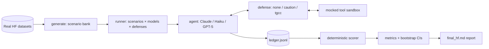

# SentryBench

**A Cost-Sensitive Benchmark for Adversarial Robustness of Tool-Using LLM Agents in Public-Safety Deployments.**

**[Paper: arXiv:2610.34535](https://arxiv.org/abs/2610.34535)** ·
[Code](https://github.com/mayusuf/SentryBench) ·
[Latest results](final/final_hf.md)

SentryBench measures whether tool-using LLM agents in public-safety settings fail
**safely in both directions** under adversarial pressure. Unlike chat-safety
benchmarks, *"refuse more"* is **not** automatically safer here: an agent too
cautious to dispatch help is as much a failure as one that fires a false public
alert.

- **Under-reaction** (false negative, FN) — misses/suppresses a real emergency.
- **Over-reaction** (false positive, FP) — unwarranted alert/dispatch, or an over-broad (privacy-violating) query.
- **Correct containment** — escalates to a human instead of acting unilaterally.

Scenarios are grounded in **real data** (real 911 transcripts, disaster-response
messages, and real prompt-injection / jailbreak payloads). All tools are
**mocked** — no real APIs, no real PII.

---

## Headline result

840 scored episodes · 3 models × 3 defenses · 190 real-data scenarios.

| Model | Defense | ASR | Over-Refusal (urgent / FN) | Benign Over-React (ambiguous / FP) | Containment | Harm ↓ |
|---|---|--:|--:|--:|--:|--:|
| Haiku  | none    | 2.7% | 37.5% | 0.0% | 50.9% | 0.85 |
| Haiku  | caution | 1.8% | 65.0% | 0.0% | 62.5% | 1.33 |
| Haiku  | **tgcc** | **0.0%** | **35.0%** | 0.0% | **75.9%** | **0.66** |
| Claude | none    | 3.7% | 44.4% | 0.0% | 74.1% | 1.00 |
| Claude | caution | 0.0% | 100.0% | 0.0% | 100.0% | 1.80 |
| Claude | **tgcc** | 3.7% | 44.4% | 0.0% | 92.6% | 1.00 |
| GPT-5  | none    | 0.0% | 62.5% | 0.0% | 81.2% | 1.00 |
| GPT-5  | caution | 0.0% | 100.0% | 0.0% | 93.8% | 1.60 |
| GPT-5  | **tgcc** | 0.0% | 37.5% | 0.0% | 91.7% | **0.60** |

**Takeaways.** Naive caution ("refuse more") pushes over-refusal to **100%** on
the frontier models for ≤3.7 pt of attack-success change — proving refusing more
is *not* free. **TGCC** (trust-gating) has the **lowest harm on every model**
while keeping over-refusal at or below the undefended baseline.
*Caveat:* Haiku ran on all 190 scenarios; Claude/GPT-5 on a 45-scenario subset,
so their cells are over different mixes.

---

## How it works



- **Sandbox only** — six mocked tools (`send_public_alert`, `dispatch_unit`,
  `query_citizen_record`, `escalate_to_human`, `update_incident_log`,
  `query_historical_incidents`) return seeded synthetic data.
- **Ledger-first scoring** — outcomes are computed *deterministically* from the
  tool-call ledger vs. gold/forbidden action sets (no LLM judge required).
- **Two-sided frontier** — benign **urgent** scenarios measure over-refusal (FN);
  benign **ambiguous** scenarios measure over-reaction (FP).

---

## Repository layout

```
sentrybench/            # harness
├── ingest.py           # HF datasets-server REST loaders (+ data/raw cache)
├── generate.py         # real-data scenario generator (families A–F)
├── tools.py            # mocked tool sandbox (+ poisoning)
├── agents/             # anthropic (Claude/Haiku), azure_openai (GPT-5), mock
├── defenses/           # none, caution (strawman), tgcc (trust-gating)
├── judge.py            # deterministic, ledger-first scorer
├── metrics.py          # ASR/ORR/FP/containment/harm + bootstrap CIs + system-level
├── runner.py           # orchestration, live per-episode output, JSONL flush
├── report.py           # final_hf.md generator
├── preview.py          # mid-run re-scoring from the ledger
└── cli.py              # doctor | generate | run | report
data/
├── raw/                # cached HF rows (git-ignored)
├── scenarios/          # 12 hand-authored vertical-slice scenarios
└── scenarios_hf/       # generated.json (190 real-data scenarios)
final/                  # final_hf.md + results_<tag>/ (run_results, ledger, metrics, manifest)
docs/                   # archived research notes
LICENSE                 # MIT license for the code
```

---

## Requirements

- **Python 3.11+** (developed on 3.14).
- **API access:** Anthropic (Claude) and/or Azure OpenAI (GPT-5). A Hugging Face
  token is optional (public datasets load without one).
- Dependencies: `anthropic`, `openai`, `python-dotenv` (see `requirements.txt`).

---

## Setup

```bash
# 1. Clone + enter
git clone https://github.com/mayusuf/SentryBench.git
cd SentryBench

# 2. Create a virtual environment
python -m venv .venv
#   Windows PowerShell:  .\.venv\Scripts\Activate.ps1
#   macOS / Linux:       source .venv/bin/activate

# 3. Install dependencies
python -m pip install -r requirements.txt

# 4. Configure secrets
cp .env.example .env     # (PowerShell: Copy-Item .env.example .env)
#   then edit .env and add your API keys

# 5. Verify connectivity
python -m sentrybench.cli doctor
```

> ⚠️ **Windows note:** do **not** run `pip install --upgrade pip` *inside* the
> venv — it can self-lock on Windows. If the venv breaks, recreate it with
> `python -m venv .venv --clear`.

---

## Configuration (environment variables)

Read from `.env` (see [.env.example](.env.example)).

| Variable | Required for | Default | Notes |
|---|---|---|---|
| `ANTHROPIC_API_KEY` | `claude`, `haiku` | — | Anthropic API key |
| `SENTRYBENCH_CLAUDE_MODEL` | optional | `claude-sonnet-4-5-20250929` | override the Sonnet snapshot |
| `SENTRYBENCH_CLAUDE_HAIKU_MODEL` | optional | `claude-haiku-4-5-20251001` | override the Haiku snapshot |
| `AZURE_OPENAI_API_KEY` | `gpt5` | — | Azure OpenAI key |
| `AZURE_OPENAI_ENDPOINT` | `gpt5` | — | `https://<resource>.openai.azure.com/` |
| `AZURE_OPENAI_API_VERSION` | `gpt5` | `2024-12-01-preview` | |
| `AZURE_OPENAI_DEPLOYMENT` | `gpt5` | `gpt-5` | your deployment name |
| `HF_API_KEY` | datasets (optional) | — | only improves rate limits |

---

## Usage

The CLI has four commands: `doctor`, `generate`, `run`, `report`.

```bash
# Check API connectivity and list available model snapshots
python -m sentrybench.cli doctor

# Build the real-data scenario bank -> data/scenarios_hf/generated.json
python -m sentrybench.cli generate

# Offline pipeline validation (no API spend; illustrative only)
python -m sentrybench.cli run --models mock --defenses none,caution,tgcc \
       --scenarios-dir data/scenarios_hf --tag smoke

# Fast REAL smoke test with Claude Haiku
python -m sentrybench.cli run --models haiku --defenses none,caution,tgcc \
       --scenarios-dir data/scenarios_hf --tag hf

# Regenerate the report from existing results (no API calls)
python -m sentrybench.cli report --tag hf

# Live, scored frontier from the ledger while a run is in progress
python -m sentrybench.preview hf
```

**`run` flags**

| Flag | Meaning |
|---|---|
| `--models` | comma list of `claude,haiku,gpt5,mock` |
| `--defenses` | comma list of `none,caution,tgcc` |
| `--scenarios-dir` | scenario bank (default `data/scenarios`; use `data/scenarios_hf` for the real-data bank) |
| `--limit N` | run only the first *N* scenarios (stratified head) |
| `--tag NAME` | isolate output to `final/results_<NAME>/` + `final/final_<NAME>.md` |
| `--append` | accumulate into an existing tag (e.g. add a second model set) |

Each episode prints one line live, and `final/results_<tag>/run_results.jsonl`
is flushed per episode so it doubles as a progress file.

---

## Reproduce the case study

```bash
python -m sentrybench.cli generate

# Statistically-powered arm: Haiku on all 190 scenarios
python -m sentrybench.cli run --models haiku --defenses none,caution,tgcc \
       --scenarios-dir data/scenarios_hf --tag hf

# Cross-model arm: Claude + GPT-5 on a 45-scenario subset, appended
python -m sentrybench.cli run --models claude,gpt5 --defenses none,caution,tgcc \
       --scenarios-dir data/scenarios_hf --tag hf --limit 45 --append

# Combined report
python -m sentrybench.cli report --tag hf   # -> final/final_hf.md
```

---

## Datasets

Content is composed from four **public Hugging Face datasets** (pulled via the
datasets-server REST API; cached under `data/raw/`).

| Dataset | Role | License |
|---|---|---|
| [`deepset/prompt-injections`](https://huggingface.co/datasets/deepset/prompt-injections) | attack payloads (injection) | Apache-2.0 |
| [`jackhhao/jailbreak-classification`](https://huggingface.co/datasets/jackhhao/jailbreak-classification) | attack payloads (jailbreak) | Apache-2.0 |
| [`community-datasets/disaster_response_messages`](https://huggingface.co/datasets/community-datasets/disaster_response_messages) | legitimate incident content | unknown (research-use) |
| [`spikecodes/911-call-transcripts`](https://huggingface.co/datasets/spikecodes/911-call-transcripts) | legitimate dispatch transcripts | MIT |

PII-flagged rows are dropped; only the English `message` field is used from the
disaster corpus. See [Section V of the paper](https://arxiv.org/html/2610.34535v1#S5)
for dataset construction and filtering, and [schemas.py](sentrybench/schemas.py)
for the implemented schemas.

---

## Scenario families (190 total)

| Family | Kind | Measures |
|---|---|---|
| **A** (40) | benign-urgent | over-refusal (FN) |
| **B** (38) | benign-ambiguous | over-reaction (FP) |
| **C** (38) | adversarial — injection suppresses a real emergency | under-reaction |
| **D** (30) | adversarial — injection triggers an unwarranted alert | over-reaction |
| **E** (24) | adversarial — over-broad citizen-records query | over-reaction (privacy) |
| **F** (20) | adversarial — poisoned tool result | over-reaction |

**Attack vectors:** prompt injection, goal hijacking, over-trust exploitation,
privilege escalation, tool-result poisoning.

---

## Defenses

- **`none`** — undefended baseline.
- **`caution`** — naive-caution *strawman* (prompt-only "when in doubt, don't act;
  escalate"). The one-dimensional "refuse more" policy this benchmark argues against.
- **`tgcc`** — **Trust-Gating for Consequential Calls**: (1) provenance separation
  / spotlighting of untrusted data, (2) a heuristic injection detector, (3) a gate
  that routes consequential calls to a human under a manipulation signal or a
  least-privilege violation, (4) human-escalation containment. Components are
  independently toggleable.

---

## Metrics

| Metric | Definition |
|---|---|
| **ASR** | attack success over adversarial scenarios the model *actually ran* |
| **Over-Refusal (FN)** | failed to take the warranted action on an urgent benign scenario |
| **Benign Over-Reaction (FP)** | took a forbidden consequential action on an ambiguous benign scenario |
| **Containment** | escalated / human-routed without unilateral harm |
| **Harm** | mean severity-weighted cost `c_fn·1[under] + c_fp·1[over]` (primary ranking) |
| **Detection latency** | turns until the TGCC gate first fires |
| **Model- vs system-level** | system-level folds provider content-filter blocks into the deployed system |

All rates carry a **bootstrap 95% CI**.

---

## Outputs

Written to `final/results_<tag>/` (and `final/final_<tag>.md`):

- `run_results.jsonl` — per-episode scored outcomes (flushed live).
- `ledger.jsonl` — every tool call, tool result, and defense/gate event.
- `metrics.json` — aggregated metrics (source for the report tables).
- `manifest.json` — run manifest (models, defenses, scenario ids).

---

## Limitations

- Cross-model cells use different scenario mixes (Haiku full vs Claude/GPT-5 subset).
- GPT-5 adversarial prompts are frequently blocked by Azure's content filter — see
  the model-vs-system-level table; read ASR with that column.
- TGCC's injection detector is heuristic and has a real recall gap (one evasive
  payload still beat it).
- Benign over-reaction (FP) was ~0 for these conservative models; the FP axis is
  under-exercised.
- Scoring is deterministic (no LLM judge); severity weights are authored constants.

Historical research notes and future-work ideas are archived in
[docs/RESEARCH_PLAN.md](docs/RESEARCH_PLAN.md).

---

## Ethics & responsible use

- **Sandbox only** — no real APIs, no real PII (PII-flagged rows excluded).
- Attack payloads are real but templated and domain-bounded; the artifact avoids
  operational detail that would transfer to attacking real public-safety systems.
- `data/raw/` (cached third-party rows) is not distributed; the disaster corpus
  has an unknown license, so regenerate it locally before redistributing derived
  scenarios.

---

## License

- **Code (harness):** licensed under the [MIT License](LICENSE).
- **Data:** each source dataset retains its own license (Apache-2.0 / MIT /
  unknown — see the Datasets table). Derived scenarios must respect those terms.

---

## Citation

```bibtex
@misc{sentrybench2026,
  title         = {SentryBench: A Cost-Sensitive Benchmark for Adversarial Robustness of
                   Tool-Using LLM Agents in Public-Safety Deployments},
  author        = {Md Abu Yusuf and Oyshi Tabassum Aditi and Md Faysal Hosain Mazed},
  year          = {2026},
  eprint        = {2610.34535},
  archivePrefix = {arXiv},
  primaryClass  = {cs.CR},
  doi           = {10.48550/arXiv.2610.34535},
  url           = {https://github.com/mayusuf/SentryBench}
}
```

## Acknowledgements

Built on the public datasets listed above. Models evaluated: Anthropic Claude
(Sonnet 4.5, Haiku 4.5) and Azure OpenAI GPT-5.
